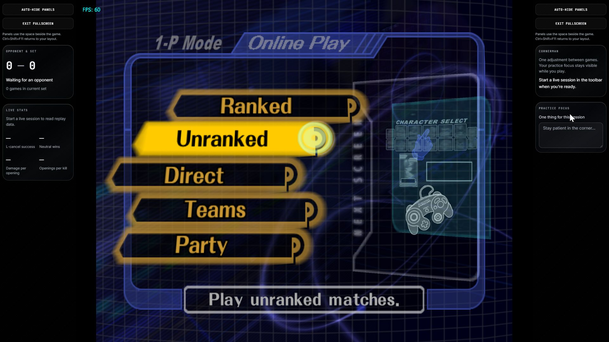
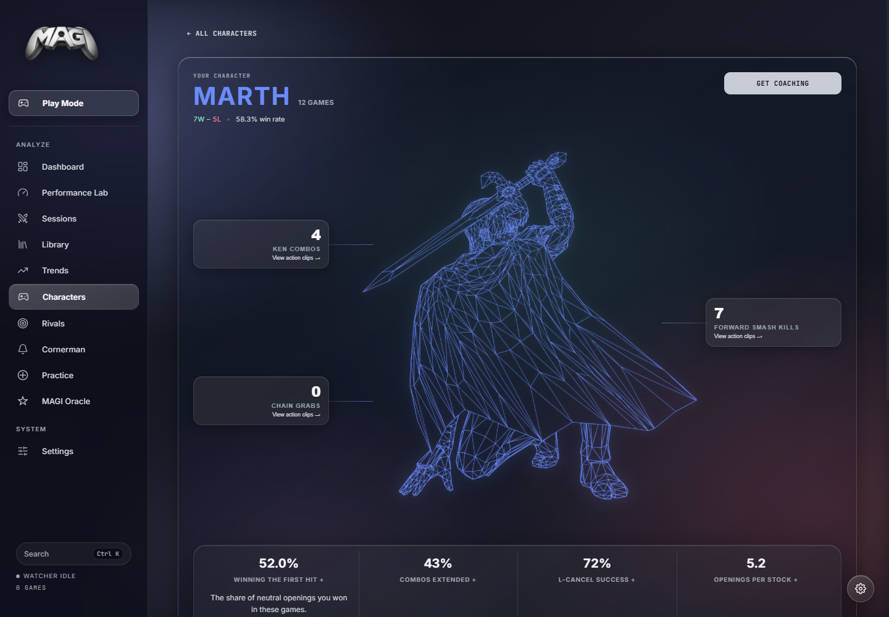
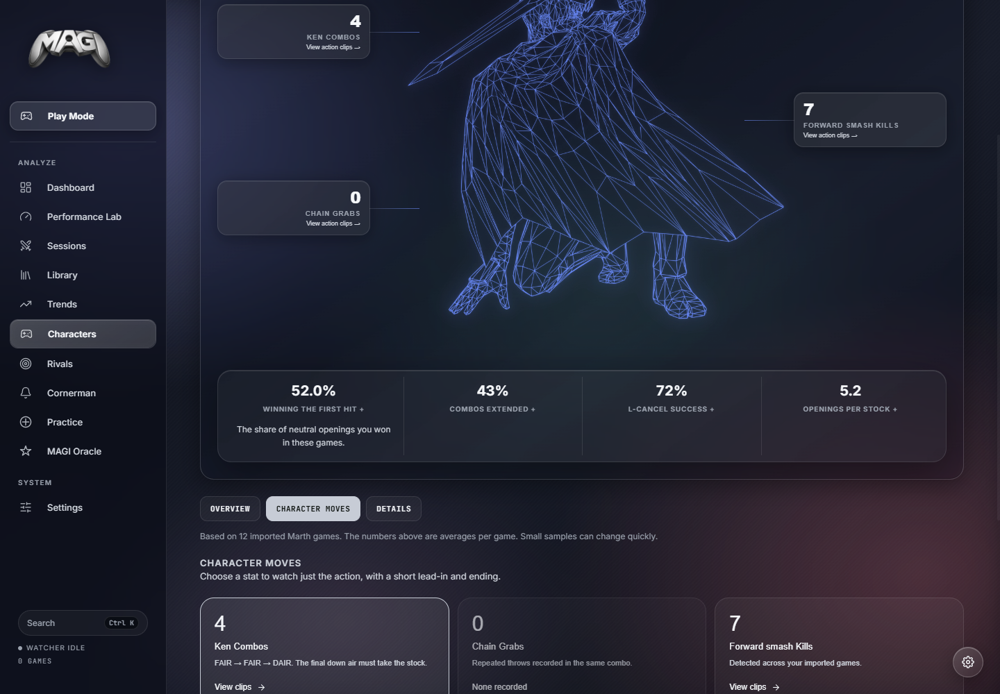

# MAGI

**Your Melee, your stats, and your coaching—all in one place.**

**[Download MAGI](https://github.com/Bloodshed-Rain/TheMAGI/releases/latest) · [Website](https://themagi.gg) · [Setup guide](docs/USER_GUIDE.md) · [Changelog](CHANGELOG.md)**

MAGI brings Slippi, replay review, stats, and coaching together so you can spend more time playing and working on your game. Play a session, see what's happening in your matches, and figure out what to work on next.

It's free and open source. You can use the stats and replay tools on their own, or add AI coaching when you want another perspective.

- **Play Slippi inside MAGI** with your stats, goals, and a live controller display beside the game (Windows).
- **Cornerman** gives live stats and between-game advice while you play.
- **Game Theater** replays any game, jumps to stocks and highlights, and plays clips of the moments being discussed.
- **Characters, Trends, Sessions, and Rivals** show how you play, how that's changing, and what your opponents do.
- **Practice and Oracle** turn your games into a plan and answer questions about them.
- **Local first.** Your replays and stats stay on your computer, and AI coaching is optional.

## Play Slippi inside MAGI

On Windows, you can play Slippi from inside MAGI itself, with your training and coaching information right beside the game. Keep an eye on your stats, follow your set score, write down a practice goal, and get advice between games—all from the same screen.

Make it your own with **Customize**. Choose what you want on each side of the game, change how much room it takes up, and save the layout you like. You can keep things simple or make room for Cornerman, Oracle, recent results, goals, notes, and a live input display that lights your controller's buttons as you press them.

Use **Fullscreen** for a bigger view. Your information can stay beside the game or tuck away until you move your mouse to the edge.

You'll need Slippi Dolphin and your own Melee game file to play. MAGI can find some existing Slippi setups for you, and the setup guide walks you through anything it needs.

## Have someone in your corner

**Cornerman** follows your games, shows live stats and event alerts, and gives you a few things to think about between games. The advice stays beside the game, so you can read it before jumping into the next one. You can also turn on voice callouts.

Live stats work without AI. Connect an AI service if you want the between-game advice.

## Go back and see what happened

Open a game in **Game Theater** to watch it again, jump to a stock or highlight, loop a section, and leave yourself a note.

Some coaching timestamps and character stats let you jump straight to a short clip from your own replay. That makes it easier to look at the moment you're working on, then try something different next session.

Not every stat has a clip. Keep your original replay files where MAGI can find them so it can play those moments back.

## Get to know your game

Your replays can tell you much more than whether you won.

- **Dashboard:** get a quick look at your results, recent form, stats, and highlights, your best character with what you do well and what to work on with them, plus MAGI's read on your whole record of games.
- **Library:** find a game by opponent, character, stage, or result.
- **Characters:** see how each character is doing, including matchups, stages, L-cancels, punish stats, recovery habits, and more. Open a stat to learn what it means or find replay examples where available.
- **Sessions and Trends:** look back over a night of games or see how your play has changed over time.
- **Rivals:** see your history against people you've played and get a scouting report to help prepare for the next set.

The more games you have, the more there is to look through. Some stats need a few games before they're useful.

## Take something into your next session

**Practice** can suggest a plan based on your games, with drills you can check off as you go. Keep a goal and a few notes visible in Play Mode to remind yourself what you're working on.

**Oracle** is there when you have a question about your play. Try asking:

- “What's changed in my last 20 games?”
- “What should I work on against Marth?”
- “I've got 30 minutes. What should I practice?”

Practice plans, Oracle answers, scouting reports, and Cornerman advice use the AI service you choose. Treat the suggestions as something to try, and check the replays when you're unsure.

## Get started

1. **[Download the latest release](https://github.com/Bloodshed-Rain/TheMAGI/releases/latest).** On Windows, choose the file named **MAGI-Setup-…exe** to install it. Close an older copy of MAGI before updating.
2. **Tell MAGI who you are.** The first-time setup asks for your Slippi connect code, or your player tag for offline games.
3. **Choose your replay folder.** Import your games, then turn on **Watch for New Games** in Settings if you want new ones added as you play.
4. **Set up playing and replay review.** The guide helps you find Slippi Dolphin and your Melee game file. Playing uses Netplay Dolphin; watching replays uses Playback Dolphin.
5. **Add coaching if you want it.** Open **Settings → AI** and choose how you want to connect.

You can finish setup later and reopen it from **Settings → Setup wizard**. Set up your controller in Dolphin before playing. MAGI doesn't include Slippi Dolphin or Melee.

**Windows:** playing inside MAGI and the built-in replay viewer are available here.

**Mac and Linux:** use MAGI for your replay library, stats, review notes, and coaching. Replays open in a separate Slippi Dolphin window. Check the download page for a build that matches your computer.

## Can I trust the numbers?

MAGI reads your replay's own frame data, not a guess at it. A stat is shown only when the replay establishes everything it claims: a named technique appears only when every required condition is met, and anything looser is described as the sequence that was actually observed. Counts, clips, highlights, live alerts, and coaching all share the same definitions.

The definitions, the evidence behind them, and the known limits are written down in [Melee accuracy notes](docs/melee-accuracy.md). If a number looks wrong to you, [open an issue](https://github.com/Bloodshed-Rain/TheMAGI/issues/new/choose) with the game and the moment.

## Do I need to pay for AI?

MAGI itself is free. Your replay library, stats, trends, notes, and Play Mode work without an AI account.

For coaching, you can connect ChatGPT, use another AI service, or run a model on your own computer. If you use ChatGPT, look for **Continue with ChatGPT** in **Settings → AI**. The models and usage available depend on your account.

An AI service or cloud voice service may charge for use or have limits. The [setup guide](docs/USER_GUIDE.md#ai-coaching-and-providers) explains the choices.

## What happens to my replays?

Your replay files stay on your computer. MAGI also saves your stats, notes, and past reports there.

When you ask an online AI service for coaching, MAGI sends it the relevant game information and your question. It doesn't upload the original replay files. Online voice services receive the text they're asked to read.

## Need a hand?

The [setup guide](docs/USER_GUIDE.md) covers playing, replay review, coaching, and settings. If something isn't working, check [troubleshooting](docs/DEVELOPMENT.md#troubleshooting) or [report a problem](https://github.com/Bloodshed-Rain/TheMAGI/issues).

More screenshots

Want to help build MAGI? Start with the [developer guide](docs/DEVELOPMENT.md) and [contribution guide](CONTRIBUTING.md). To report a security problem, see the [security policy](SECURITY.md).

**Version 1.16.0** · [What's changed](CHANGELOG.md) · [MIT License](LICENSE)

MAGI stands for *Melee Analysis through Generative Intelligence*.
