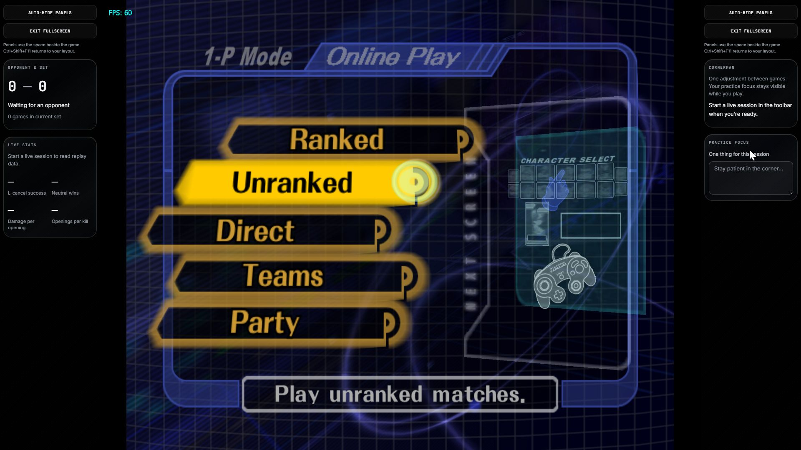
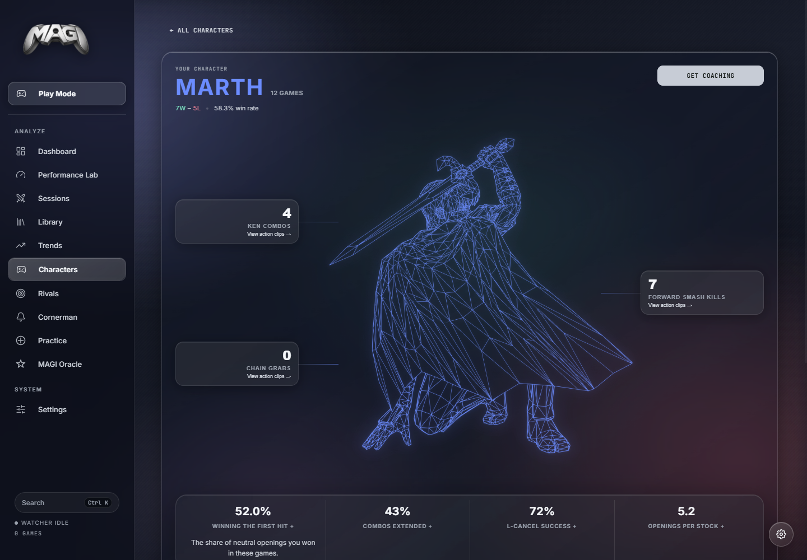
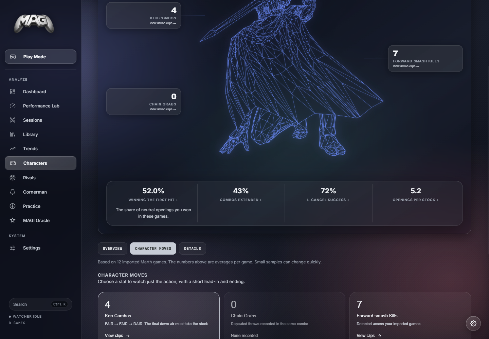
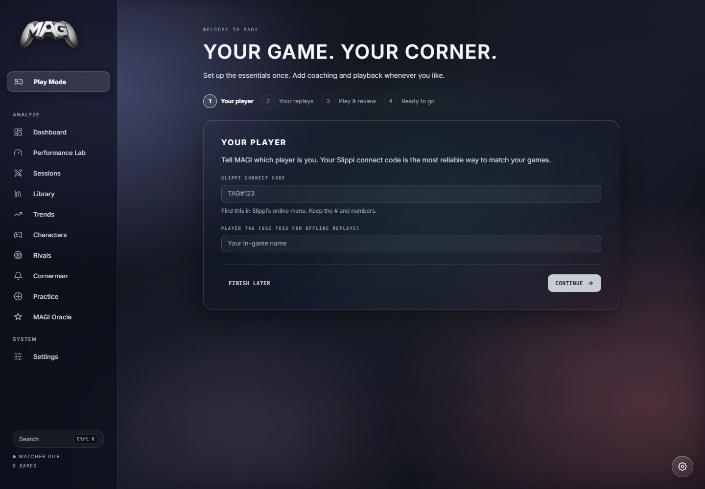

# MAGI

**Melee Analysis through Generative Intelligence**

Source version **1.10.1** · [Release notes](CHANGELOG.md) · [Detailed user guide](docs/USER_GUIDE.md)

The release badge below shows the latest published build, which may lag this checkout. Check the release notes for the version you download.

[](https://github.com/Bloodshed-Rain/TheMAGI/releases)
[](https://github.com/Bloodshed-Rain/TheMAGI/actions/workflows/build.yml)
[](LICENSE)
[](https://github.com/Bloodshed-Rain/TheMAGI/releases)
[](https://slippi.gg/)

MAGI is a free, open-source desktop workspace for Super Smash Bros. Melee. On Windows, **Play Mode** brings your Slippi Netplay Dolphin, live stats, Cornerman coaching, practice focus, and notes together beside the game. Your Slippi `.slp` files also become a searchable local library with frame-derived analytics, replay review, character action clips, opponent dossiers, and optional AI coaching.

- **Replay-native:** analysis is built from the actual decisions and events in your Slippi files.
- **Local-first:** replays, parsed stats, notes, configuration, and cached reports live on your machine.
- **AI-optional:** parsing, analytics, browsing, notes, and game hosting work without AI. Add an eligible ChatGPT plan connection, your own API key, a local model, or the optional no-key provider for coaching. Hosted services have their own availability and usage limits.
- **Practice-oriented:** MAGI connects trends, matchups, habits, and replay moments to specific review targets and drills.

**Website:** [themagi.gg](https://themagi.gg)<br>
**Downloads:** [GitHub Releases](https://github.com/Bloodshed-Rain/TheMAGI/releases)<br>
**Source:** [github.com/Bloodshed-Rain/TheMAGI](https://github.com/Bloodshed-Rain/TheMAGI)



## What's new

- **Play Mode and Fullscreen:** host Netplay Dolphin on Windows, arrange and resize panels on either side, save layouts, and keep the game at 4:3. Panels can stay visible in the side space or reveal on hover. Available panels include live stats, opponent and set tracking, Cornerman, Oracle, recent form, practice focus, and notes.
- **Integrated Cornerman:** live events, running stats, between-game coaching, and optional voice live in MAGI and Play Mode. The former separate popup window has been removed. The live session reads the hosted Dolphin's replay output rather than assuming your import folder is its live source.
- **Character overviews and bounded action clips:** large character artwork, explained core metrics, move and technique breakdowns, and expandable habit, recovery, stock-loss, stage, and career details. Supported examples open short replay clips when timestamp evidence and the replay file are available.
- **Resumable setup:** a first-run wizard for identity, replay import, and optional Dolphin/game-image paths, with checks and a Finish later option.
- **ChatGPT plan connection:** browser sign-in, account-provided models, refresh, account switching, disconnect, and usage management for optional coaching. Eligibility and usage limits depend on your account.
- **Four appearance options:** Liquid, Telemetry, Tournament, and Light, shared by the main app and Play Mode. Saved CRT and Amber selections migrate to Liquid.

The [changelog](CHANGELOG.md) also describes the stricter Ken Combo definition, historical data repair, and coaching accuracy requirements.

## Table of Contents

- [Quick Start](#quick-start)
- [Play Mode and Live Coaching](#play-mode-and-live-coaching)
- [Features](#features)
- [Screenshots](#screenshots)
- [What MAGI Measures](#what-magi-measures)
- [AI Coaching and Providers](#ai-coaching-and-providers)
- [Replay Playback](#replay-playback)
- [Local Data and Privacy](#local-data-and-privacy)
- [Install a Release](#install-a-release)
- [Development Setup](#development-setup)
- [Historical Replay Backfill](#historical-replay-backfill)
- [CLI Workflows](#cli-workflows)
- [Architecture](#architecture)
- [Troubleshooting](#troubleshooting)
- [Current Boundaries](#current-boundaries)
- [Contributing](#contributing)
- [License](#license)

## Quick Start

1. Download and open MAGI from [GitHub Releases](https://github.com/Bloodshed-Rain/TheMAGI/releases).
2. Follow the **setup wizard**, which opens automatically on a fresh installation. Enter your Slippi connect code (or your player tag for offline games).
3. Choose your Slippi replay folder and select **Import my replays**. Subfolders are included; duplicates are skipped. You can also import later.
4. Optionally configure Slippi **Netplay Dolphin**, **Playback Dolphin**, and your own Melee game image. Detected paths are filled in for you. **Check setup** verifies readable paths; launching a game is the final compatibility check.
5. Open the Dashboard, launch Play Mode on Windows, or configure optional coaching in **Settings → AI**.

Use **Finish later** to save your progress. Reopen the guide with **Settings → Setup wizard**. Existing installations keep their settings and are not forced through onboarding.

For automatic imports, enable **Settings → Replays → Watch for New Games**. Configure your controller in Dolphin before playing. MAGI does not include Slippi Dolphin or a Melee game image.

Replay parsing, statistics, browsing, trends, and manual notes do not require an AI provider.

## Play Mode and Live Coaching

**Play Mode (Windows):** Open **Play Mode** from the sidebar or command palette for a dedicated workspace with Melee in the center and configurable sidebars. Use **Settings → Play Mode settings** to select Slippi **Netplay** Dolphin and your Melee image; this is separate from Playback Dolphin used by Game Theater. Slippi Launcher's usual Windows installation and ISO settings are detected when available.

Use **Customize** to select and reorder panels independently on either side, adjust sidebar widths, choose live statistics, collapse either sidebar, or apply Minimal, Live Coaching, and Practice presets. Layout, practice focus, and notes are saved locally. **Back to MAGI** hides the game while preserving its process; returning to Play Mode restores it. **Stop Game** ends the game, and quitting MAGI closes its hosted Dolphin session.

**Fullscreen:** The game keeps its 4:3 aspect ratio, with information visible in the unused space beside it by default. Choose **Customize → Fullscreen panels → Auto-hide until hovered** for edge reveal. When the side space is too narrow for readable panels, edge reveal is used automatically. **Ctrl+Shift+F11** returns to the regular layout. Sidebar visibility controls live in Customize.

Cornerman runs inside Play Mode; there is no separate popup window. Use **Settings → Play Mode settings → Enable Cornerman in Play Mode** to control its live-session button and automatic tracking. Game paths and the replay output folder are configured in the same Settings section. Voice and optional desktop notifications remain under **Settings → Cornerman**.

Play Mode uses the existing Cornerman service for live tracking and coaching. Configure your player identity in Settings first. Tracking, watching, and the game have independent controls: leaving Play Mode does not stop the live session. Oracle and Cornerman use your configured AI provider; game hosting, replay parsing, layout, notes, and focus do not require AI. Native hosting does not yet support macOS or Linux.

Launching Melee in Play Mode starts live tracking automatically when Cornerman is enabled and your player identity is configured. MAGI reads the hosted Dolphin's `SlippiReplayDir` and replay-saving setting, so an old import folder cannot silently receive the live session. **Start live session** also prepares that folder and enables live stats. The setup strip shows the replay source and AI readiness separately; **Stop live session** stops Cornerman, while the app-wide import watcher stays active.

## Features

| Area                | What it provides                                                                                                                                                                                                                                                                                                                                        |
| ------------------- | ------------------------------------------------------------------------------------------------------------------------------------------------------------------------------------------------------------------------------------------------------------------------------------------------------------------------------------------------------- |
| **Dashboard**       | Overall record, recent form, rolling stat cards, recent games, detected highlights, and an Oracle summary of recent play.                                                                                                                                                                                                                               |
| **Performance Lab** | A current-form scorecard against the prior baseline, wins-versus-losses comparisons, actionable signals, a prioritized replay-review queue, and a manual training log for drills, friendlies, tournaments, coaching, and VOD review.                                                                                                                    |
| **Library**         | Search and filter recent games by opponent, character, stage, and result, then open any game in the review workspace. Duplicate replay files are skipped by SHA-256 hash.                                                                                                                                                                               |
| **Sessions**        | Calendar-day game groups with result strips, opponent summaries, and cached or regenerated AI session reports.                                                                                                                                                                                                                                          |
| **Trends**          | Rolling performance charts for neutral, conversion, execution, punish, recovery, and survival metrics over configurable ranges.                                                                                                                                                                                                                         |
| **Characters**      | A compact overview with explained stats, character move counts linked to short action clips, and expandable topics for habits, recovery, stock losses, stages, and lifetime totals. Ken combos, multi-shines, and other supported sequences play with a short lead-in and a bounded ending. Some older or count-only stats do not have clip timestamps. |
| **Rivals**          | Searchable opponent history, head-to-head records, recent form, character and stage breakdowns, game links, and generated scouting dossiers.                                                                                                                                                                                                            |
| **Game Theater**    | Replay playback, scrubbing and transport controls, stock markers, highlight clips, optional looping, game-level coaching, timestamp seeking, stats, and persistent review notes.                                                                                                                                                                        |
| **Cornerman**       | Watches a live Slippi folder, tracks the current game and set, surfaces live alerts and running stats, and generates concise between-game adjustments. Coaching and live alerts appear directly in Play Mode panels, with optional desktop notifications and system/OpenAI/Azure voice.                                                                 |
| **Practice**        | AI-generated practice plans based on detected weaknesses, with drill-level completion tracking and plan history.                                                                                                                                                                                                                                        |
| **MAGI Oracle**     | Persistent chat grounded in recent local game context for questions about matchups, habits, changes in form, and what to review next.                                                                                                                                                                                                                   |
| **Play Mode**       | Windows workspace with hosted Netplay Dolphin, configurable panels for live stats, opponent/set tracking, Cornerman, Oracle, recent form, practice focus, and notes; saved layouts and Fullscreen preserve the 4:3 game image.                                                                                                                                                                                                                |
| **Setup wizard**    | Resumable first-run guide for player identity, replay imports, and optional game paths. Reopen it from Settings.                                                                                                                                                                                                                                        |
| **Settings**        | Player identity, themes and density, replay import/watching, Cornerman behavior, Dolphin paths, AI providers and models, and local-data maintenance.                                                                                                                                                                                                    |

## Screenshots









## What MAGI Measures

MAGI parses Slippi game, frame, input, and interaction data into a local SQLite database. Depending on the replay and available sample size, it tracks:

- game result, stage, duration, stocks, characters, opponent tag, and connect code
- neutral wins and losses, neutral win rate, openings, conversions, conversion rate, damage per opening, and openings per kill
- L-cancel rate, wavedashes, dash-dance frames, platform time, airtime, and ledge time
- recovery attempts, route and landing outcomes, double-jump timing, contested recoveries, edgeguard commitment depth, and edgeguard success
- blocked-hit frame gaps, out-of-shield decisions, punish windows, pressure quality, shield breaks, shield pokes, and powershields
- whiff-punish opportunities, capture rate, reaction delay, and move-by-move whiff exposure
- measured directional influence on deaths, self-destructs, unused recovery resources, throw DI, average death percent, and survival estimates
- ledge, knockdown, shield, and other situational habits, including cornered/pressured splits and punished choices
- character-specific signature events and per-character totals across all 26 fighters
- highlight moments such as high-damage conversions, spikes, zero-to-deaths, comebacks, four-stocks, and character-specific sequences

These metrics are descriptive. MAGI displays sample counts and suppresses some conclusions until enough observations exist.

## AI Coaching and Providers

AI coaching is optional. In **Settings → AI → ChatGPT plan**, select **Continue with ChatGPT**, complete sign-in and plan-usage consent in your browser, and choose an available model. The connection supplies coaching for Cornerman, Oracle, replay reports, and practice generation. It does not grant access to your ChatGPT conversations. Tokens use OS-encrypted main-process storage; account switching, refresh, disconnect, and **Manage usage** are available. Eligibility, model access, and usage limits are determined by OpenAI. [Official sign-in documentation](https://developers.openai.com/siwc/token-sharing-open-source).

MAGI also supports API-key and local-model workflows:

| Provider           | Key required | Notes                                                                                            |
| ------------------ | ------------ | ------------------------------------------------------------------------------------------------ |
| ChatGPT plan       | No API key   | Browser sign-in and plan-usage consent; account eligibility, available models, and limits apply. |
| OpenAI             | Yes          | Coaching plus optional streamed Cornerman text-to-speech.                                        |
| Azure OpenAI       | Yes          | Requires an Azure resource endpoint and deployment name; also supports optional Cornerman voice. |
| OpenRouter         | Yes          | Select from supported hosted models or enter a custom model ID.                                  |
| Anthropic          | Yes          | Direct Anthropic model access.                                                                   |
| Google Gemini      | Yes          | Direct Gemini model access.                                                                      |
| Ollama / LM Studio | No           | Uses a local OpenAI-compatible endpoint, defaulting to `http://localhost:1234/v1`.               |
| Pollinations       | No           | Optional no-key hosted provider; availability and usage limits apply.                                          |

Provider-aware model selection and model discovery are available in Settings. Analysis requests are queued, streamed where appropriate, retried on transient failures, and cached locally when possible.

AI suggestions can be wrong. Replay timestamps and bounded clips are available for supported moments, not every AI claim. Named Melee techniques require their specific evidence; an approximate hit sequence does not confirm a technique. See the [technical accuracy policy](docs/melee-accuracy.md).

AI appears in:

- dashboard summaries
- individual game coaching
- character analysis and identity blurbs
- session reports
- rival dossiers
- practice-plan generation
- Cornerman adjustments
- Oracle chat

Example Oracle questions:

- “Why am I losing to Marth this week?”
- “What changed in my last 20 games?”
- “Which opponent habits am I failing to punish?”
- “What should I drill today if I only have 30 minutes?”

### Development API keys

For development, copy `.env.example` to `key.env` and fill only the providers you use:

```bash
OPENAI_API_KEY=
AZURE_OPENAI_API_KEY=
AZURE_OPENAI_ENDPOINT=
OPENROUTER_API_KEY=
ANTHROPIC_API_KEY=
GEMINI_API_KEY=
```

`key.env` is ignored by Git and is never bundled into release builds. Released builds accept credentials through Settings.

## Replay Playback

MAGI launches Slippi Dolphin from the replay path stored during import and can seek to specific frames from stock markers, highlights, or coaching timestamps.

- **Windows:** Game Theater can position the Dolphin playback window inside MAGI and provides playback controls, timeline scrubbing, marker-based clips, and looping.
- **macOS and Linux:** the same review actions open playback externally in Slippi Dolphin; embedded playback is not available.
- **Requirements:** Slippi Dolphin and a legally obtained Melee ISO. MAGI tries common Slippi Launcher locations first, and both paths can be set manually in Settings.

Moving or deleting an imported `.slp` file leaves its statistics in MAGI, but playback for that game will be unavailable until the stored file path is valid again.

## Local Data and Privacy

MAGI does not require an account or a MAGI-hosted backend.

| Data                                | Default location                                               |
| ----------------------------------- | -------------------------------------------------------------- |
| SQLite database                     | `~/.magi-melee/magi.db`                                        |
| App configuration and provider keys | `~/.magi-melee/config.json`                                    |
| ChatGPT connection tokens           | `~/.magi-melee/chatgpt-auth.enc`, encrypted with OS credential storage |
| Development-only environment keys   | `key.env` in the repository root                               |
| Replay files                        | Your existing Slippi folder; MAGI does not copy or delete them |

Replay parsing, statistics, training logs, review notes, and cached analyses remain local. When a hosted AI provider is selected, MAGI sends the assembled coaching prompt and relevant derived game context to that provider. Raw `.slp` files are not uploaded by MAGI. Choose the local Ollama/LM Studio provider if you want the coaching request itself to remain on your machine.

**Do not commit** `key.env`, API keys, `.slp` files, or personal database files. Clearing data from Settings removes imported games, stats, notes, and generated analyses from MAGI's database; it does not delete the original replay files.

## Install a Release

Download the latest package from [GitHub Releases](https://github.com/Bloodshed-Rain/TheMAGI/releases):

- **Windows x64:** NSIS installer or portable `.exe`
- **macOS Intel / Apple Silicon:** `.dmg`
- **Linux x64:** `.AppImage`; local builds can also produce `.deb`

Package and architecture availability depends on the release. Native Play Mode hosting and embedded replay playback are Windows-only. MAGI does not include Slippi Dolphin or a Melee game image.

Packaged builds check GitHub Releases for updates when the app launches. Availability and signing behavior can vary by platform and release.

## Development Setup

See the [development guide](docs/DEVELOPMENT.md) for the full command reference, architecture, historical backfill, troubleshooting, and release process.

### Prerequisites

- Node.js `^20.19.0` or `>=22.12.0`
- npm
- Git
- A platform compiler toolchain if a native dependency does not have a compatible prebuilt binary

### Clone and run

```bash
git clone https://github.com/Bloodshed-Rain/TheMAGI.git
cd TheMAGI
npm ci
npx electron-rebuild
npm run dev
```

`electron-rebuild` compiles native dependencies such as `better-sqlite3` and `koffi` for Electron's ABI. Run it again after changing Electron versions or when startup reports a native module version mismatch.

### Commands

| Command                  | Purpose                                                         |
| ------------------------ | --------------------------------------------------------------- |
| `npm run dev`            | Compile main/preload code, start Vite, and launch Electron.     |
| `npm run typecheck`      | Type-check both the Electron and renderer TypeScript projects.  |
| `npm test`               | Run the complete Vitest suite once.                             |
| `npm run test:watch`     | Run Vitest in watch mode.                                       |
| `npm run lint`           | Check `src/` with ESLint.                                       |
| `npm run lint:fix`       | Apply safe ESLint fixes.                                        |
| `npm run format:check`   | Check TypeScript/TSX formatting with Prettier.                  |
| `npm run format`         | Format TypeScript/TSX source files.                             |
| `npm run build:renderer` | Create a production renderer bundle without packaging Electron. |
| `npm run build`          | Type-check, build, and package for the current platform.        |
| `npm run build:win`      | Build Windows installer and portable packages.                  |
| `npm run build:mac`      | Build macOS Intel and Apple Silicon DMGs.                       |
| `npm run build:linux`    | Build Linux AppImage and Debian packages.                       |

CI runs type checking, tests, lint, and formatting on pull requests and pushes to `main`. Version tags (`v*`) build release artifacts for Windows, macOS, and Linux.

## Historical Replay Backfill

New imports automatically populate MAGI's detailed event tables. Games imported before those tables were introduced need a one-time backfill for the full Character analytics suite, including measured DI, recovery routes, shield decisions, habit instances, and whiff-punish data.

Close MAGI before running the backfill. The command is safe to rerun: each game's event rows are replaced transactionally, and the replay hash is checked before data is attached to an existing database row.

**PowerShell:**

```powershell
$env:ELECTRON_RUN_AS_NODE = "1"
npx electron --require tsx/cjs src/backfill-cli.ts
Remove-Item Env:ELECTRON_RUN_AS_NODE
```

**macOS / Linux:**

```bash
ELECTRON_RUN_AS_NODE=1 npx electron --require tsx/cjs src/backfill-cli.ts
```

Append either option to the platform-specific command above before clearing `ELECTRON_RUN_AS_NODE`:

```bash
# Process only the first 25 candidates as a smoke test
npx electron --require tsx/cjs src/backfill-cli.ts --limit 25

# Rebuild event rows for every imported game
npx electron --require tsx/cjs src/backfill-cli.ts --force
```

Keep `ELECTRON_RUN_AS_NODE=1` set when using either option. Missing replay files and files whose current hash no longer matches the imported replay are reported and skipped rather than misattributed.

## CLI Workflows

The desktop app is the primary interface. These source-only utilities are useful for development and diagnostics:

```bash
# Parse one or more replays without an AI call
npx tsx src/pipeline-cli.ts path/to/game.slp --target "TAG#123"

# Print structured JSON
npx tsx src/pipeline-cli.ts path/to/game.slp --target "TAG#123" --json

# Detect sets in a directory, then analyze one set
npx tsx src/pipeline-cli.ts --dir path/to/replays --sets
npx tsx src/pipeline-cli.ts --dir path/to/replays --set 3 --target "TAG#123"

# Save source-development configuration
npx tsx src/setup.ts --tag YourTag --code "TAG#123" --folder path/to/replays

# Watch a replay folder outside the desktop UI
npx tsx src/watcher.ts path/to/replays --target "TAG#123"
```

Database-backed Node CLIs can report `NODE_MODULE_VERSION` after native packages have been rebuilt for Electron. The backfill command above deliberately runs through Electron's Node runtime to avoid that mismatch.

The repository also includes a standalone read-only MCP server in `src/mcp-server.ts` for advanced local integrations. It is not started by the desktop app.

## Architecture

```text
.slp replay files
  → parallel Slippi parsing
  → game summaries + frame-derived events + highlights
  → local SQLite database in ~/.magi-melee
  → typed Electron IPC/preload bridge
  → React query layer and desktop UI
  → optional queued LLM coaching + local cache
```

MAGI uses three application layers:

1. **Electron main process** owns filesystem access, SQLite, replay parsing, AI requests, file watching, Dolphin launch/embedding, updates, and IPC handlers.
2. **Preload bridge** exposes a typed, deliberately limited `window.clippi` API to the renderer.
3. **React renderer** provides the Vite-built interface, routes, local UI state, and query-backed views.

### Project layout

| Path                                 | Responsibility                                                                                                                              |
| ------------------------------------ | ------------------------------------------------------------------------------------------------------------------------------------------- |
| `src/main/`                          | Electron startup, IPC registration, handlers, updater, dialogs, native Windows replay embedding, and the application window.                |
| `src/preload/`                       | Typed bridge between Electron and React.                                                                                                    |
| `src/renderer/`                      | React pages, components, hooks, stores, themes, assets, and styles.                                                                         |
| `src/pipeline/`                      | Slippi parsing, frame/event extraction, derived insights, character data, signatures, highlights, and prompt assembly.                      |
| `src/db.ts`                          | SQLite schema, migrations, transactions, inserts, and application queries.                                                                  |
| `src/importer.ts`                    | Replay hashing, deduplication, parallel parsing, persistence, sessions, and progress reporting.                                             |
| `src/llm.ts` / `src/llmProviders.ts` | Provider abstraction, streaming, response validation, and provider metadata.                                                                |
| `src/backfill.ts`                    | Transactional historical event-data backfill engine.                                                                                        |
| `tests/`                             | Vitest coverage for parsing, event extraction, database behavior, imports, LLM handling, replay review, settings, UI utilities, and stores. |
| `site/`                              | Static project website.                                                                                                                     |
| `screenshots/`                       | README and marketing screenshots.                                                                                                           |

## Troubleshooting

### Reopen setup or recover from a failed step

Choose **Settings → Setup wizard**. Progress is saved when you continue or finish later. Canceling a file picker preserves your current selection; failed imports and checks leave the guide open so you can fix the location and retry. AI is optional and never blocks setup.

An empty folder can be readable without containing games. If import finds no `.slp` files, play a game with replay saving enabled, then import again. If files are skipped because the player cannot be found, check your connect code before importing more games.

### Play Mode cannot launch or live stats stay empty

Hosted Play Mode currently requires Windows. Choose the **Netplay** Dolphin executable for live play; Game Theater uses a separate **Playback** executable. Both need a readable Melee game image. The wizard checks file access, not game-image integrity, controller configuration, network access, or provider availability.

Enable replay saving in Dolphin, and use its replay output folder for live tracking. Set your player identity before launching a live session. AI coaching additionally needs a configured, available provider; live parsing and stats do not.

### MAGI does not recognize my player

Set your connect code in **Settings → Profile** and import again. Tags can change or collide; a connect code is generally the strongest identifier. Existing incorrectly attributed games may need to be cleared and reimported.

### Import reports skipped games

MAGI hashes every replay and skips duplicates, including duplicate files discovered within the same import batch. Skips are expected when re-importing a folder.

### Detailed Character cards are missing or empty

Some cards require minimum sample sizes. If the games were imported by an older MAGI version, run the [historical replay backfill](#historical-replay-backfill).

### Replay playback cannot find Dolphin or the ISO

Set both paths under **Settings → Playback**. MAGI can auto-detect common Slippi Launcher locations, but custom installations may need explicit paths. Embedded playback is Windows-only.

### Cornerman is not receiving games

Confirm your player identity and enable Cornerman in **Settings → Play Mode settings**. Launching Melee starts tracking automatically when configured; **Start live session** can also prepare the hosted Dolphin's replay folder. The folder must be writable by Slippi and readable by MAGI, and replay saving must be enabled. The Cornerman page also offers Corner Sessions. Live voice is opt-in under **Settings → Cornerman**.

### A hosted AI provider fails

For ChatGPT plan coaching, check the connection, plan-usage consent, available model, and account usage limits; use **Refresh connection & models** or reconnect if needed. API-key providers need a valid key, endpoint where required, and model or Azure deployment name. Local providers must expose an OpenAI-compatible endpoint. Core replay analytics remain available while AI is unavailable.

### Development startup reports `NODE_MODULE_VERSION`

Rebuild native modules for the installed Electron version:

```bash
npx electron-rebuild
```

Then rerun `npm run dev`.

## Current Boundaries

- Native Play Mode hosting and embedded Game Theater playback are Windows-only; macOS and Linux use external Slippi Dolphin playback.
- Detailed event cards are sample-gated and cannot recover data from replay files that were moved, replaced, or deleted before a historical backfill.
- Hosted-provider availability, pricing, model IDs, quotas, and output quality are controlled by those providers.
- Pollinations is an optional no-key hosted provider; its availability and limits are controlled by the provider.
- MAGI is a local desktop application, not a hosted replay-storage service.

## Contributing

Issues and pull requests are welcome. Keep changes focused, add regression coverage for parsing/database/import behavior, and include screenshots or a short recording for visible UI changes.

Before opening a pull request, run:

```bash
npm run typecheck
npm test
npm run lint
npm run format:check
npm run verify:docs
npm run verify:release
```

## License

[MIT](LICENSE) © 2026 Bloodshed-Rain
